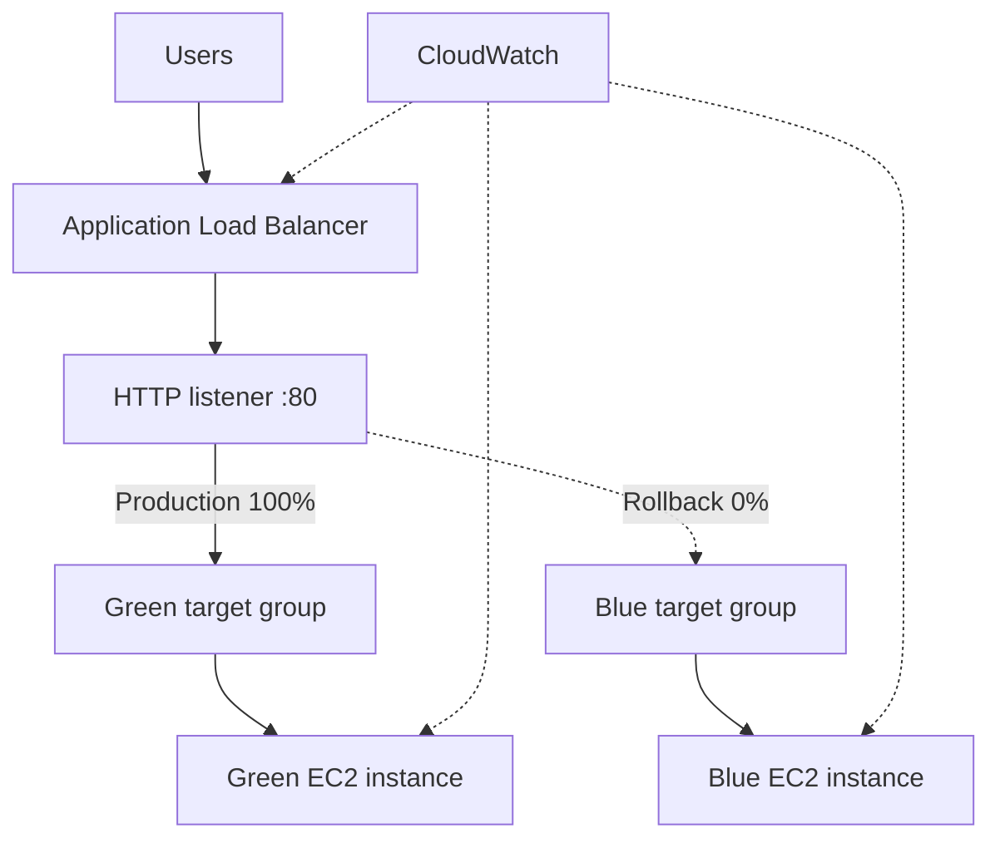

# AWS Blue-Green Deployment

A completed EC2-based Blue-Green deployment demonstration using an Application Load Balancer (ALB), separate target groups, and Amazon CloudWatch.

**Final production environment: Green.** The deployment was switched to Green, deliberately rolled back to Blue for validation, and then restored to Green. Both environments returned HTTP 200 from their `/health` endpoint during their respective tests.

## Examiner quick links

| Item | Link | What it demonstrates |
|---|---|---|
| Live application | [Open production application](http://blue-green-alb-381653284.us-west-2.elb.amazonaws.com/) | ALB currently routes production traffic to Green |
| Live health check | [Open production health endpoint](http://blue-green-alb-381653284.us-west-2.elb.amazonaws.com/health) | Expected response: `healthy` |
| GitHub repository | [Project source and documentation](https://github.com/RURIGIMK/aws-blue-green-deployment) | Scripts, architecture, monitoring, rollback and report |
| Architecture | [Deployed architecture](architecture/blue-green-architecture.md) | Actual AWS network and deployment design |
| Traffic switch and rollback | [Traffic switching guide](docs/traffic-switch-and-rollback.md) | Green cutover, Blue rollback and recovery checks |
| CloudWatch monitoring | [Dashboard and alarms](docs/cloudwatch-monitoring.md) | Dashboard metrics, alarm thresholds and limitations |
| Deployment scripts | [Scripts directory](scripts/) | EC2 user data, validation and traffic switching scripts |
| Implementation report | [Final implementation report](report/implementation-report.md) | Configuration, validation results and limitations |
| Evidence index | [Screenshots directory](screenshots/) | Evidence captured from the AWS console |

### AWS console views

These links require an AWS account with permission to view the project resources. Select **US West (Oregon), us-west-2** if prompted.

- [CloudWatch dashboard: BlueGreenDeploymentMonitoring](https://us-west-2.console.aws.amazon.com/cloudwatch/home?region=us-west-2#dashboards:name=BlueGreenDeploymentMonitoring)
- [CloudWatch alarms](https://us-west-2.console.aws.amazon.com/cloudwatch/home?region=us-west-2#alarmsV2:)
- [EC2 load balancers](https://us-west-2.console.aws.amazon.com/ec2/home?region=us-west-2#LoadBalancers:)
- [EC2 target groups](https://us-west-2.console.aws.amazon.com/ec2/home?region=us-west-2#TargetGroups:)

## Project objective

Demonstrate a controlled deployment strategy in which two separate application environments are maintained behind one ALB. The ALB listener controls which target group receives production traffic. Green is validated before cutover, while Blue remains available as a rollback target.

## Deployed architecture

| Component | Deployed configuration |
|---|---|
| Region | US West (Oregon), `us-west-2` |
| VPC | `blue-green-vpc`, `10.0.0.0/16` |
| Public subnet A | `10.0.0.0/20`, `us-west-2a` |
| Public subnet B | `10.0.16.0/20`, `us-west-2b` |
| Load balancer | `blue-green-alb` |
| ALB DNS | `blue-green-alb-381653284.us-west-2.elb.amazonaws.com` |
| Blue instance | `blue-web-1`, `i-0b5bb01e9de1eb394` |
| Green instance | `green-web-1`, `i-09be9ec1beab95ecb` |
| Blue target group | `blue-green-blue-tg` |
| Green target group | `blue-green-green-tg` |
| Application | Amazon Linux 2023 with Apache HTTP Server |
| Health endpoint | `/health`, returns `healthy` |
| Final listener weights | Green 100%, Blue 0% |

## Implementation and validation results

| Activity | Observed result |
|---|---|
| Blue environment deployment | Blue page served through the ALB; `/health` returned `healthy` |
| Green environment deployment | Green target became healthy; Green page and health endpoint were tested |
| Green production cutover | ALB served the Green application |
| Rollback test | Listener was changed to Blue 100%; Blue page and `/health` were verified |
| Recovery | Listener was restored to Green 100%; Green page and `/health` were verified |
| Temporary validation rule | Removed after Green validation |
| CloudWatch | Dashboard and five alarms created |

The rollback test was a controlled listener change. No instance failure was injected. The test demonstrates traffic recovery to the retained Blue environment, not automatic failover.

## CloudWatch monitoring

Dashboard: `BlueGreenDeploymentMonitoring`

Alarms created:

- `Blue-High-CPU`: Blue EC2 CPU utilization above 80%.
- `Green-High-CPU`: Green EC2 CPU utilization above 80%.
- `ALB-High-Response-Time`: average target response time above 1 second.
- `Blue-No-Healthy-Hosts`: Blue target group's minimum healthy host count below 1.
- `Green-No-Healthy-Hosts`: Green target group's minimum healthy host count below 1.

The dashboard includes EC2 CPU and available ALB request, response-time and target 4XX metrics. The CloudWatch metric browser did not expose the target 5XX metric in the selected per-load-balancer metric group during setup, so 4XX was retained as an additional observable metric. The project does not claim that 4XX is a substitute for 5XX monitoring. See [monitoring details](docs/cloudwatch-monitoring.md).

## Repository structure

| Path | Purpose |
|---|---|
| `architecture/` | Deployed architecture and design |
| `docs/` | Implementation, monitoring and rollback documentation |
| `scripts/` | User data, health validation and listener traffic-switch scripts |
| `screenshots/` | Final AWS evidence |
| `report/` | Implementation report |

## Reproducing the deployment

1. Review the [architecture](architecture/blue-green-architecture.md) and [implementation report](report/implementation-report.md).
2. Launch the Blue and Green EC2 instances using the matching user-data scripts in `scripts/`.
3. Create the two target groups and ALB listener using the documented health-check path.
4. Register each instance in its matching target group and wait for both targets to become healthy.
5. Run `scripts/health-check.sh` against the ALB endpoint.
6. Use `scripts/switch-traffic.sh green` to direct traffic to Green.
7. If validation fails, use `scripts/switch-traffic.sh blue` to roll back.
8. Follow the [traffic-switch guide](docs/traffic-switch-and-rollback.md) and [monitoring guide](docs/cloudwatch-monitoring.md).

The scripts require AWS CLI credentials with the relevant permissions. They do not contain credentials. Review and configure environment variables before running them.

## Scope and limitations

- Two EC2 instances, two target groups, one ALB and CloudWatch are used.
- No ECS, RDS, NAT Gateway, custom domain, HTTPS certificate or paid automation service is included.
- The example application is a static Apache page used to distinguish environments.
- HTTP is used for this instructional lab. It is not a production security recommendation.
- The rollback is manual through the ALB listener. No automatic rollback controller was configured.
- Memory metrics were not added because the default EC2 metrics do not include memory utilization.
- The lab resources may incur charges. Review AWS billing and remove resources after assessment evidence has been captured.

## Security

Never commit AWS access keys, secret keys, passwords, private keys, session tokens or other credentials. Use an AWS CLI profile or environment-based authentication outside the repository. The scripts accept resource identifiers through environment variables.

## Status

**Implementation complete and verified.** Final production routing is Green 100%, Blue 0%. The examiner can use the live application and health-check links above, then inspect the implementation details and evidence in this repository.
