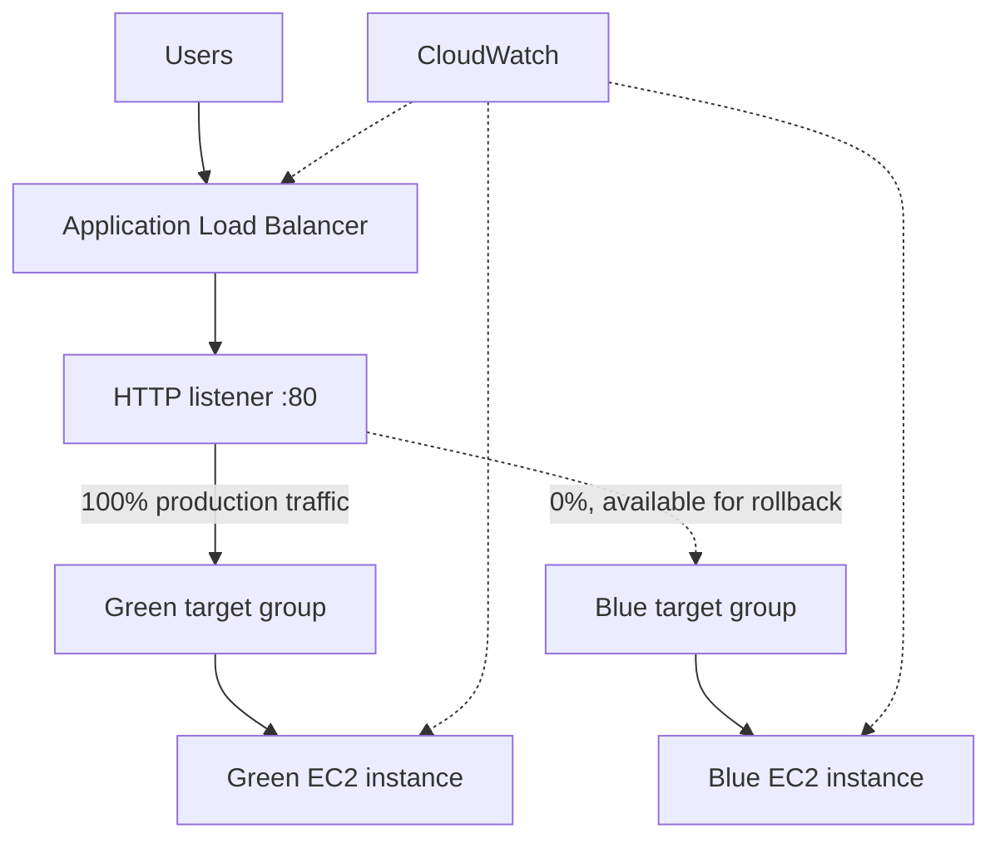

# AWS Blue-Green Deployment

This project demonstrates a Blue-Green deployment using two Amazon EC2 web servers, an Application Load Balancer (ALB), separate target groups and Amazon CloudWatch.

The Green environment is currently receiving production traffic. I also switched traffic back to Blue to test the rollback procedure, then restored Green.

## Application and AWS links

- [Open the application](http://blue-green-alb-381653284.us-west-2.elb.amazonaws.com/)
- [Check application health](http://blue-green-alb-381653284.us-west-2.elb.amazonaws.com/health) (expected response: `healthy`)
- [CloudWatch dashboard](https://us-west-2.console.aws.amazon.com/cloudwatch/home?region=us-west-2#dashboards:name=BlueGreenDeploymentMonitoring)
- [CloudWatch alarms](https://us-west-2.console.aws.amazon.com/cloudwatch/home?region=us-west-2#alarmsV2:)
- [EC2 load balancers](https://us-west-2.console.aws.amazon.com/ec2/home?region=us-west-2#LoadBalancers:)
- [EC2 target groups](https://us-west-2.console.aws.amazon.com/ec2/home?region=us-west-2#TargetGroups:)

The AWS console links open in US West (Oregon), `us-west-2`, and require permission to view the resources.

## Architecture

The deployment uses one VPC across two Availability Zones. The ALB receives HTTP traffic on port 80 and forwards it to one of two target groups. Each target group contains its own EC2 instance.

| Resource | Configuration |
|---|---|
| Region | US West (Oregon), `us-west-2` |
| VPC | `blue-green-vpc`, CIDR `10.0.0.0/16` |
| Public subnet A | `10.0.0.0/20`, `us-west-2a` |
| Public subnet B | `10.0.16.0/20`, `us-west-2b` |
| Load balancer | `blue-green-alb` |
| ALB DNS | `blue-green-alb-381653284.us-west-2.elb.amazonaws.com` |
| Blue instance | `blue-web-1`, Amazon Linux 2023, `t3.micro` |
| Green instance | `green-web-1`, Amazon Linux 2023, `t3.micro` |
| Target groups | `blue-green-blue-tg`, `blue-green-green-tg` |
| Health check | HTTP `/health`, expected response `healthy` |
| Current listener weights | Green 100%, Blue 0% |

## Deployment and test results

Blue was deployed first and checked through the ALB. Green was then launched in its own target group and tested before the listener was changed.

The listener was set to Green 100% and Blue 0%. The Green page was displayed and the health endpoint returned `healthy`. I then changed the listener to Blue 100% and Green 0%. The Blue page and health endpoint both worked. Finally, I restored Green to 100% and confirmed the Green page and health endpoint again.

The rollback was performed manually by editing the ALB listener. I did not stop or damage an instance, and automatic rollback was not configured.

## CloudWatch

The dashboard is named `BlueGreenDeploymentMonitoring`. It contains:
- CPU utilization for the Blue and Green EC2 instances.
- ALB request count.
- ALB target response time.
- ALB target 4XX response count.

Five alarms were created:

| Alarm | Condition |
|---|---|
| `Blue-High-CPU` | Blue CPU utilization above 80% |
| `Green-High-CPU` | Green CPU utilization above 80% |
| `ALB-High-Response-Time` | Average target response time above 1 second |
| `Blue-No-Healthy-Hosts` | Blue target group has fewer than one healthy host |
| `Green-No-Healthy-Hosts` | Green target group has fewer than one healthy host |

The alarms were created without notification actions. The metric browser did not show the target 5XX metric in the per-load-balancer group during setup. The dashboard therefore shows target 4XX count as a separate metric; it is not a substitute for 5XX monitoring. More detail is in [CloudWatch monitoring](docs/cloudwatch-monitoring.md).

## Screenshot evidence

The repository contains screenshots of the application, monitoring and deployed AWS resources.

| Screenshot | Evidence |
|---|---|
| [Blue Environment](screenshots/Blue%20Environment.png) | Blue application page served through the ALB |
| [Production Green Environment](screenshots/Production%20Green%20Environment.png) | Green application page served through the ALB |
| [Healthy Status](screenshots/Healthy%20Status.png) | Health endpoint response |
| [CloudWatch Dashboard](screenshots/CloudWatch%20Dashboard.png) | CPU and ALB metric charts |
| [CloudWatch Alarms](screenshots/CloudWatch%20Alarms.png) | Five alarms, all shown in OK state |
| [VPC configuration](screenshots/vpc-configuration.png) | VPC name, ID and Available state |
| [VPC subnets](screenshots/vpc-subnets.png) | Both named public subnets and Available states |
| [ALB security group](screenshots/security-group-alb.png) | ALB security group identity and inbound-rule count |
| [EC2 security group](screenshots/security-group-ec2.png) | EC2 security group identity and inbound-rule count |
| [EC2 instances](screenshots/ec2-instances.png) | Blue and Green instance names, IDs, running states and instance types |
| [Blue target group](screenshots/blue-target-health.png) | Blue target group summary showing one healthy target |
| [Green target group](screenshots/green-target-health.png) | Green target group summary showing one healthy target |
| [Production listener weights](screenshots/production-listener-weights.png) | Green 100%, Blue 0% on the HTTP:80 default action |

Some AWS console captures show resource summary pages rather than the underlying configuration tables. In particular, the VPC and subnet images do not display CIDR values, the security-group images do not display the inbound rule details, the EC2 list does not show Availability Zones, and the target-group images show aggregate health counts rather than the registered-target rows. The listener screenshot does show the final forwarding weights. See the [screenshot notes](screenshots/README.md) for the evidence boundaries of each image.

## Repository contents

- [Architecture](architecture/blue-green-architecture.md)
- [Traffic switching and rollback](docs/traffic-switch-and-rollback.md)
- [CloudWatch monitoring](docs/cloudwatch-monitoring.md)
- [Implementation notes](docs/implementation-plan.md)
- [Deployment scripts](scripts/README.md)
- [Implementation report](report/implementation-report.md)
- [Screenshots](screenshots/)

## Scripts

The `scripts/` directory contains the EC2 user-data files, a health-check script and a script for changing the ALB listener weights.

The traffic-switch script requires AWS CLI v2 and an authenticated AWS profile or role with permission to describe the load balancer and target groups and modify the listener. It changes live traffic, so check the AWS account, region and target health before running it.

## Scope

This lab uses two EC2 instances, two target groups, one ALB and CloudWatch. It does not use ECS, RDS, NAT Gateway, a custom domain, HTTPS or automated deployment orchestration. The application pages are static and are used to identify which environment receives traffic.

HTTP is used for this exercise. A production deployment should use HTTPS and review network isolation, administrative access, alert notifications and automated recovery.
