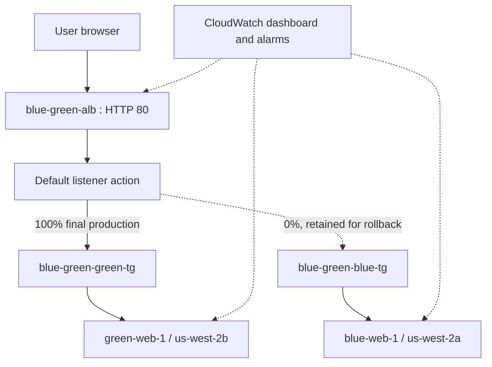

# Deployed Blue-Green Architecture

## 1. Overview

The project implements a two-environment deployment on Amazon EC2 behind one internet-facing Application Load Balancer (ALB). Blue and Green each have a dedicated target group. The ALB listener controls production routing.

The final production state is Green at 100% and Blue at 0%. Both target groups remain available so that the listener can be changed manually to restore Blue if Green fails validation.

## 2. Deployed resources

| Resource | Actual configuration |
|---|---|
| Region | US West (Oregon), `us-west-2` |
| VPC | `blue-green-vpc`, ID `vpc-0bb17d89970fff415`, CIDR `10.0.0.0/16` |
| Public subnet A | `blue-green-subnet-public1-us-west-2a`, `10.0.0.0/20`, AZ `us-west-2a` |
| Public subnet B | `blue-green-subnet-public2-us-west-2b`, `10.0.16.0/20`, AZ `us-west-2b` |
| Internet Gateway | `blue-green-igw` |
| Public route table | `blue-green-rtb-public` |
| ALB security group | `blue-green-alb-sg`, inbound TCP 80 from `0.0.0.0/0` |
| EC2 security group | `blue-green-ec2-sg`, inbound TCP 80 only from the ALB security group |
| Load balancer | `blue-green-alb`, internet-facing, HTTP listener on port 80 |
| ALB DNS | `blue-green-alb-381653284.us-west-2.elb.amazonaws.com` |

## 3. Compute and target groups

| Environment | EC2 instance | Private IP | Availability Zone | Target group | Target group ARN |
|---|---|---|---|---|---|
| Blue | `blue-web-1`, `i-0b5bb01e9de1eb394` | `10.0.10.74` | `us-west-2a` | `blue-green-blue-tg` | `arn:aws:elasticloadbalancing:us-west-2:325657596892:targetgroup/blue-green-blue-tg/46008680c6484925` |
| Green | `green-web-1`, `i-09be9ec1beab95ecb` | `10.0.26.92` | `us-west-2b` | `blue-green-green-tg` | `arn:aws:elasticloadbalancing:us-west-2:325657596892:targetgroup/blue-green-green-tg/a1ffaecf78b51d86` |

Both instances use Amazon Linux 2023 and `t3.micro`. Apache HTTP Server serves a simple environment-specific page. The health endpoint is the static file `/health`, which returns the text `healthy`.

## 4. Target health checks

Both target groups use HTTP on port 80, health-check path `/health`, success code 200, interval 15 seconds, timeout 5 seconds, healthy threshold 2 and unhealthy threshold 2. Both registered targets were observed as Healthy during implementation.

## 5. Network and security

The VPC has two public subnets in separate Availability Zones. Both subnets have public IPv4 auto-assignment enabled and route internet-bound traffic through the Internet Gateway.

The ALB security group accepts HTTP traffic on port 80 from the internet. The EC2 security group accepts HTTP traffic only from the ALB security group. No inbound SSH rule was required for this demonstration.

This is a simplified lab network. The instances are placed in public subnets, but the security group prevents direct public HTTP access to the application instances. A production design would normally consider private application subnets, HTTPS, stronger application health checks, and controlled administrative access.

## 6. Traffic routing and validation

1. Blue was launched and registered in the Blue target group.
2. The ALB initially served the Blue page.
3. Green was launched and registered in the Green target group.
4. Green health was verified. A temporary query-string listener rule routed a test request to Green while the default route remained Blue.
5. The temporary validation rule was deleted.
6. The default listener action was changed to Green 100%, Blue 0%.
7. The ALB returned the Green page and `/health` returned `healthy`.
8. For rollback validation, the listener was changed to Blue 100%, Green 0%. The Blue page and health endpoint were verified.
9. The listener was restored to Green 100%, Blue 0%. The Green page and health endpoint were verified again.

The temporary query-string rule is not present in the final listener configuration.

## 7. Logical architecture

## 8. Monitoring

CloudWatch dashboard: `BlueGreenDeploymentMonitoring`.

Alarms:
- `Blue-High-CPU`: CPUUtilization above 80%.
- `Green-High-CPU`: CPUUtilization above 80%.
- `ALB-High-Response-Time`: average TargetResponseTime above 1 second.
- `Blue-No-Healthy-Hosts`: minimum HealthyHostCount below 1 for Blue.
- `Green-No-Healthy-Hosts`: minimum HealthyHostCount below 1 for Green.

See [CloudWatch monitoring](../docs/cloudwatch-monitoring.md) for dimensions, periods, metric availability and limitations.

## 9. Operational references

- [Traffic switch and rollback](../docs/traffic-switch-and-rollback.md)
- [Implementation report](../report/implementation-report.md)
- [Scripts](../scripts/README.md)

---
Status: deployed configuration and observed validation results recorded.
