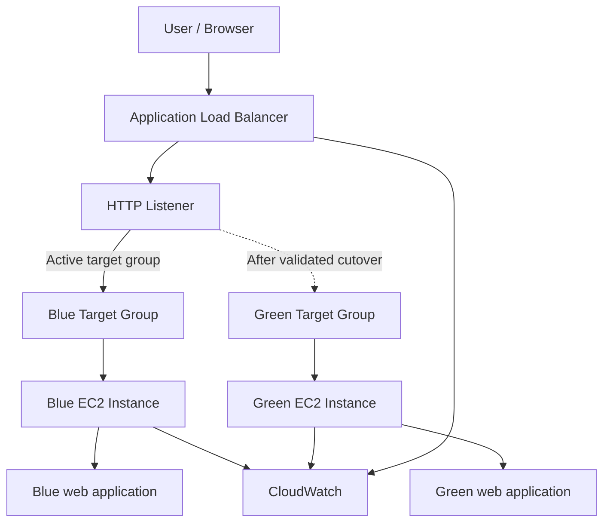

# Phase 1: Architecture and AWS Prerequisites

## 1. Architecture decision

The project will use an EC2-based blue-green deployment behind one internet-facing Application Load Balancer (ALB). Blue and Green are separate EC2 environments. Each environment is registered with its own ALB target group.

This is intentionally a focused web-tier implementation. ECS/Fargate and RDS are not included in the baseline because the assignment makes the application tier optional and the deployment strategy can be demonstrated without adding unnecessary services or cost.

## 2. Logical architecture

The listener will forward production traffic to Blue initially. Green will be deployed and registered separately, then validated through its target-group health status and a direct test path before the listener's default forwarding action is changed. The rollback procedure will restore the listener to Blue.

## 3. Planned AWS resources

| Resource | Baseline configuration | Purpose |
|---|---|---|
| VPC | Default VPC if suitable and permitted | Network boundary |
| Subnets | Two public subnets in distinct Availability Zones for the ALB; EC2 placement follows account limits | ALB availability and instance connectivity |
| Security groups | ALB security group and EC2 target security group | Restrict inbound access |
| EC2 Blue | Smallest permitted eligible instance type | Current application version |
| EC2 Green | Same instance type as Blue | Candidate application version |
| Target group Blue | HTTP, application port, health path `/health` | Blue target registration and health |
| Target group Green | HTTP, application port, health path `/health` | Green target registration and health |
| Application Load Balancer | Internet-facing, HTTP listener for the lab unless HTTPS is available without extra cost | Single entry point and traffic switching |
| CloudWatch | ALB and EC2 metrics, dashboard, alarms | Operational monitoring |

The project region is confirmed as **US West (Oregon), `us-west-2`**. The AWS account is reported by the user to have full permissions. Actual instance type, AMI, VPC, subnet IDs and ports will be selected only after the account inventory and service quotas are inspected.

## 4. Network and security rules

- ALB security group: allow inbound HTTP (TCP 80) from the internet for the lab. HTTPS will only be added if a suitable certificate and domain are available without introducing unnecessary cost.
- EC2 security group: allow the application port (planned TCP 80) only from the ALB security group. Do not expose the application port directly to the internet.
- SSH: avoid opening SSH to the world. Prefer Systems Manager Session Manager if the account has the required IAM role and connectivity. Otherwise use a narrowly scoped temporary source IP rule and remove it after administration.
- Use an instance role for AWS access where required. Do not put access keys, passwords or secrets in scripts or GitHub.
- Use synthetic/demo content only. No personal or confidential data will be placed on the instances.

## 5. Deployment and validation sequence

1. Confirm the AWS account, region, permissions, service quotas and budget constraints.
2. Inspect the VPC and available subnets; do not create networking resources until the existing setup is understood.
3. Create the ALB security group and the EC2 target security group.
4. Create the Blue and Green target groups with matching health-check settings.
5. Launch and validate Blue, then attach it to the Blue target group.
6. Create the ALB and listener, initially forwarding to Blue.
7. Launch Green, register it with the Green target group, and wait for a healthy target status.
8. Smoke-test Green before changing production listener routing.
9. Switch the listener to Green and verify the application response and CloudWatch metrics.
10. If validation fails, switch the listener back to Blue and verify recovery.

## 6. Health-check and smoke-test design

The web application will expose a lightweight `/health` endpoint that returns HTTP 200 only when the web process is ready to serve requests. The page will identify the environment and release/version so that the active deployment can be distinguished during testing.

ALB target-group health is a deployment gate, not the only test. Before cutover, Green must:
- report healthy in the Green target group;
- return HTTP 200 from its health endpoint;
- serve the expected Green release identifier;
- pass a basic browser or HTTP smoke test.

ALB health checks are configured per target group and the load balancer routes to healthy registered targets. Health-check success alone does not prove every application function works.

## 7. Monitoring baseline

The initial dashboard and alarms will use metrics available without installing additional agents:
- EC2 CPU utilization;
- ALB request count;
- ALB HTTP 5XX responses;
- ALB target 5XX responses;
- ALB target response time;
- healthy and unhealthy host counts.

Memory utilization is not available as a standard EC2 metric; it will be omitted unless CloudWatch Agent installation is supported and justified. Alarm thresholds will be documented and selected after a baseline test, rather than presented as universal production thresholds.

## 8. Cost and safety controls

- Use the smallest instance type permitted by the account and keep both instances running only for the lab period.
- The account is a full-permission account, not assumed to be an AWS Academy sandbox. Check the AWS Billing console and Cost Explorer before deployment. An Application Load Balancer is billed hourly and by LCU usage; EC2 instances and public IPv4 addresses are billed separately. Do not leave the load balancer or instances running after the lab.
- Avoid NAT gateways, RDS, paid domain registration, paid certificates and other optional resources unless explicitly approved.
- Tag resources with `Project=BlueGreenDeployment`, `Environment=Blue` or `Environment=Green`, and `Owner=StudentLab` where tags are supported.
- Record resource IDs and region in the implementation notes.
- Delete lab resources after evidence and assessment requirements are satisfied, while retaining repository documentation and screenshots.

## 9. AWS prerequisites to verify

- AWS account type and whether the account is still active.
- Region selected for the project: `us-west-2` (confirmed).
- Permission to use EC2, VPC, Elastic Load Balancing, CloudWatch and Systems Manager (if using Session Manager).
- EC2 instance-type availability and vCPU quota.
- Permission to create security groups, target groups, listeners and load balancers.
- Availability of two suitable subnets in separate Availability Zones.
- Any AWS Academy restrictions, spending limits or automatic lab shutdown rules.

## 10. AWS references

- [ALB target groups](https://docs.aws.amazon.com/elasticloadbalancing/latest/application/load-balancer-target-groups.html)
- [ALB target-group health checks](https://docs.aws.amazon.com/elasticloadbalancing/latest/application/target-group-health-checks.html)
- [ALB security groups](https://docs.aws.amazon.com/elasticloadbalancing/latest/application/load-balancer-update-security-groups.html)

---
Status: architecture baseline documented; region `us-west-2` confirmed by user. No AWS resources have been created yet.
