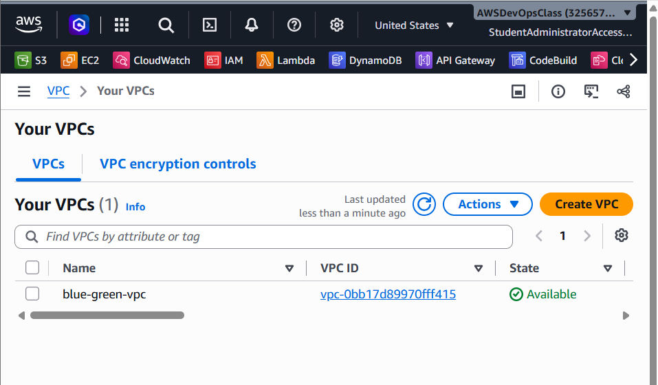
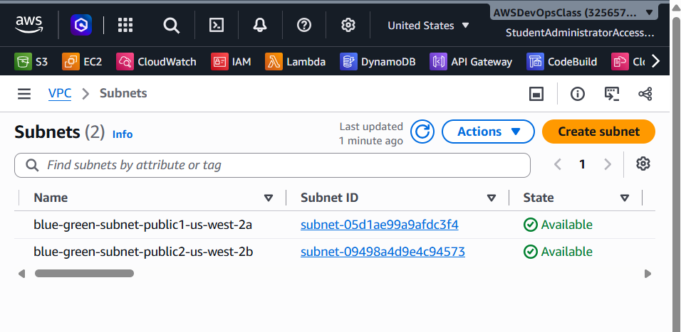
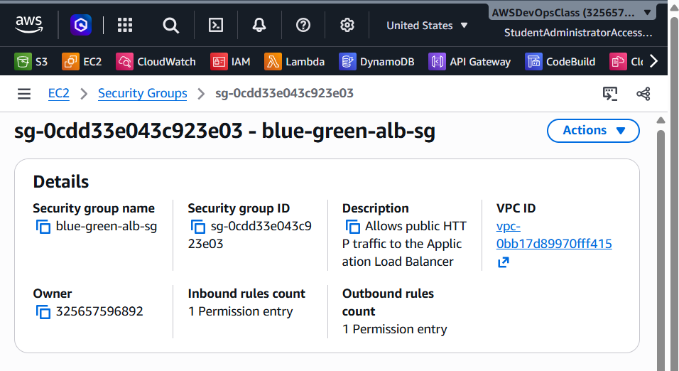
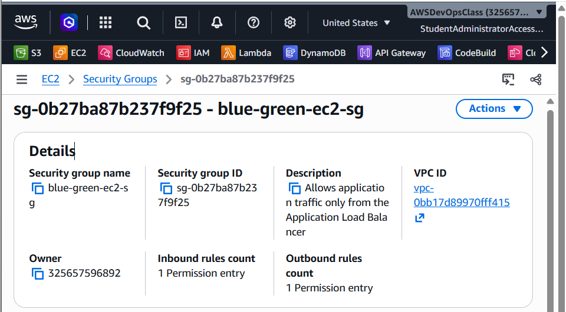
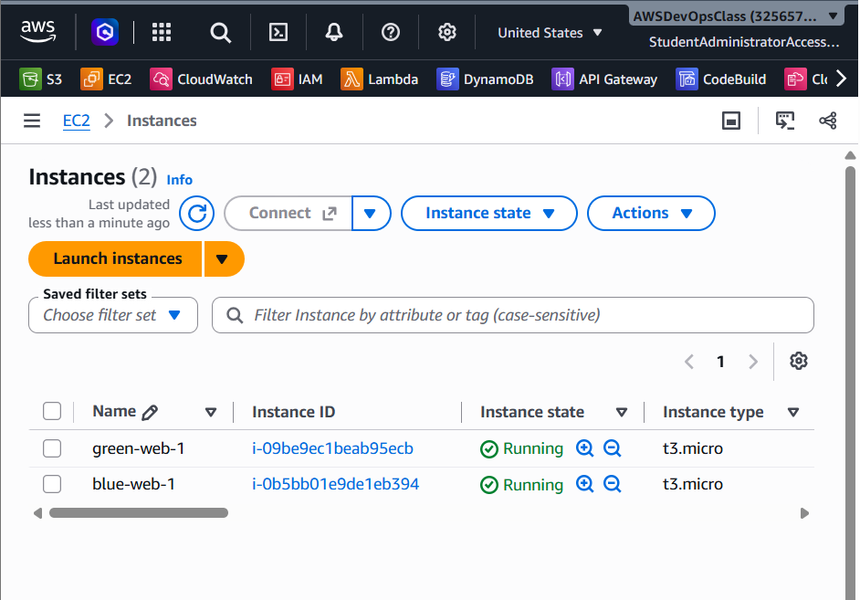
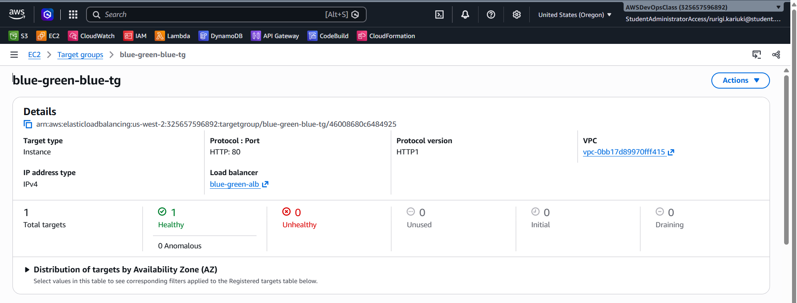
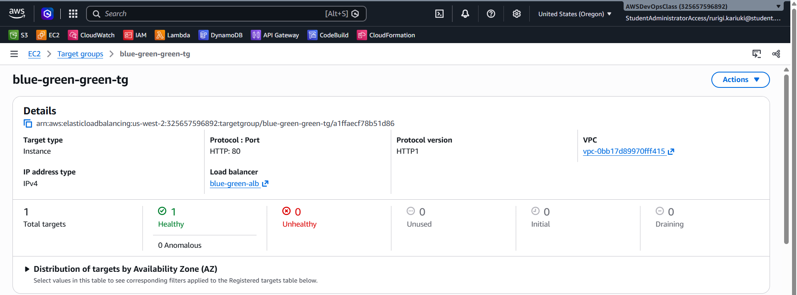
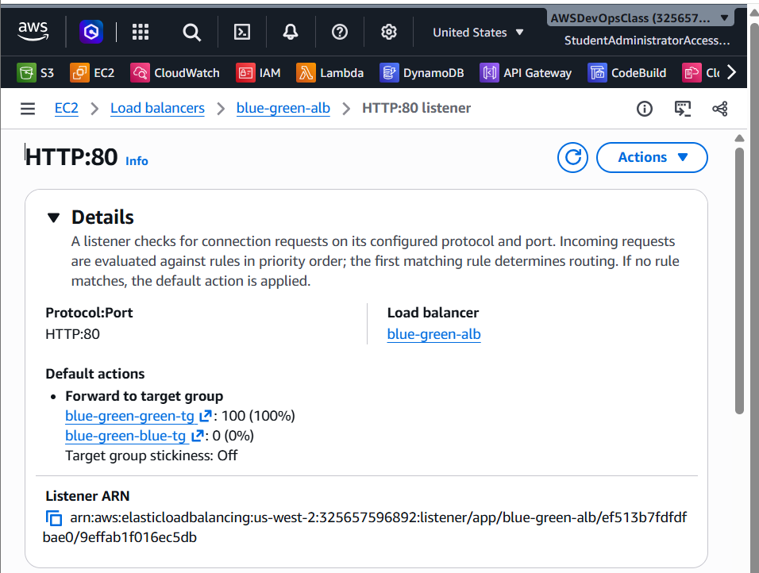

# Screenshots

This folder contains evidence captured from the running application and the AWS console. The notes below describe what is visible in each image and distinguish the information shown from configuration details that are not visible in the capture.

## Application checks

### Blue Environment

The ALB served the Blue page during the Blue routing test. The page identifies the environment as BLUE.

### Production Green Environment

The ALB served the Green page after the production listener was switched to Green.

### Health endpoint

The browser shows the response from the ALB health endpoint: `healthy`.

## CloudWatch

### Dashboard

The dashboard contains a CPU utilization chart for both EC2 instances and an ALB chart containing request count, target response time and target 4XX count.

### Alarms

The alarm list shows five alarms:
- `Blue-No-Healthy-Hosts`
- `Green-No-Healthy-Hosts`
- `ALB-High-Response-Time`
- `Green-High-CPU`
- `Blue-High-CPU`

All five alarms are shown in the **OK** state in this capture. No alarm actions are configured.

## VPC and networking

### VPC

The VPC list shows `blue-green-vpc`, its VPC ID and an Available state. The CIDR value is not visible in this screenshot.

### Subnets

The subnet list shows the two named subnets:
- `blue-green-subnet-public1-us-west-2a`
- `blue-green-subnet-public2-us-west-2b`

Both are shown as Available. The subnet CIDR blocks and Availability Zone columns are not visible in this capture.

### ALB security group

The details page identifies `blue-green-alb-sg` and shows that it has one inbound permission entry. The actual inbound rule row, including protocol, port and source, is not visible.

### EC2 security group

The details page identifies `blue-green-ec2-sg` and shows one inbound permission entry. The actual inbound rule row and source security group are not visible.

## Compute and load balancing

### EC2 instances

The instances table shows:
- `green-web-1`, running, `t3.micro`
- `blue-web-1`, running, `t3.micro`

The instance IDs are visible. Availability Zones are not shown in this capture.

### Blue target group

The `blue-green-blue-tg` summary shows one total target, one healthy target and zero unhealthy targets. The registered-target row and instance ID are not visible.

### Green target group

The `blue-green-green-tg` summary shows one total target, one healthy target and zero unhealthy targets. The registered-target row and instance ID are not visible.

### Production listener weights

The HTTP:80 listener default action forwards to:
- `blue-green-green-tg`: 100%
- `blue-green-blue-tg`: 0%

Target group stickiness is shown as Off. This is direct visual evidence of the final production traffic distribution.

## Evidence boundaries

The images confirm resource identities and selected states, but several captures do not show the detailed configuration rows. The current VPC screenshot does not show the VPC CIDR, the subnet screenshot does not show subnet CIDRs or Availability Zones, and the security-group screenshots do not show the actual inbound rules. The target-group screenshots show aggregate healthy counts rather than registered-target details. The EC2 list does not show Availability Zones.

The listener screenshot clearly shows the final Green 100% / Blue 0% weights. The Blue rollback weights are documented as a test performed during implementation, but a screenshot of the listener in the rollback state is not included here.
